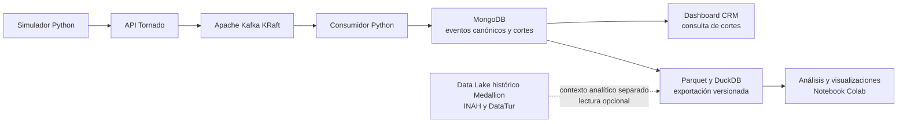

# Arquitectura Kappa para un CRM turístico de San Luis Potosí

Procesamiento continuo de eventos, almacenamiento de grandes volúmenes y controles para una campaña publicitaria sustentable.

| Para consultar | Recurso |
|---|---|
| Resultados ejecutados | [Google Colab](https://colab.research.google.com/drive/1fS4TH9e0PiOsWHfEhIpZRNRcSa1rA10J?usp=sharing) · [Notebook en GitHub](UCA01_BigData04_Kappa_CRM_SLP.ipynb) · [Descargar HTML y abrirlo localmente](https://raw.githubusercontent.com/ElgueraAI/SLP-BigData-Reproducible/main/bigdata04-kappa-crm/UCA01_BigData04_Kappa_CRM_SLP.html) |
| Instrucciones y evidencia | [Guía para el profesor](LEEME_PROFESOR.pdf) · [Auditoría de entrega](evidencias/AUDITORIA_DE_ENTREGA.md) · [Diccionario de datos](evidencias/DICCIONARIO_DE_DATOS.md) |
| Sistema completo | [Descargar ZIP](https://raw.githubusercontent.com/ElgueraAI/SLP-BigData-Reproducible/main/bigdata04-kappa-crm/UCA01_BigData04_Kappa_CRM_SLP_Reproducible.zip) · [Huellas SHA-256](SHA256SUMS.txt) |

## 1. Descripción del proyecto

Big Data 04 corresponde a la UCA de Herramientas para el Almacenamiento de Grandes Volúmenes, semestre 2026-2. El problema prototípico requiere integrar almacenamiento, análisis y decisiones para una campaña turística inteligente y sustentable. El laboratorio procesa eventos continuos de un CRM ficticio, mide su comportamiento operativo y registra motivos de elegibilidad para orientar una campaña. Mercadotecnia Digital puede reproducir cómo el acceso, el cupo y el historial de decisiones modifican la recomendación de promoción. Los clics y cupos del ejercicio son [SIMULADO].

## 2. Arquitectura implementada



Kafka separa la recepción de las proyecciones. El consumidor confirma offsets después de persistir y deduplica al reprocesar. El dashboard consulta MongoDB en vivo y Parquet y DuckDB conservan cortes verificables para el análisis. Las series oficiales de INAH y DataTur aportan contexto, con unidades y periodos propios. El CRM recibe eventos del simulador y el portal turístico carece de una conexión activa con el CRM. [Arquitectura histórica](../docs/arquitectura.md).

## 3. Tecnologías

| Componente | Versión y función |
|---|---|
| Apache Kafka | 4.3.1 en modo KRaft, un broker y una réplica. |
| MongoDB y mongosh | MongoDB 8.0.16. Eventos, proyecciones, historial y estado del consumidor. |
| Python y Tornado | Python 3.12 en el entorno WSL2 verificado. Tornado 6.5.10 para la API y el servidor del dashboard. Cliente Kafka confluent-kafka 2.15.1. |
| Parquet y DuckDB | PyArrow 25.0.1 y DuckDB 1.5.5 para exportación y consulta. |
| Docker y Ubuntu WSL2 | Docker Engine 29.8.1 y Compose 5.5.1 observados en Ubuntu 24.04 x86-64. |
| HTML y JavaScript | Dashboard con consulta local a la API y actualización periódica. |
| Google Colab | Ejecuta el notebook con Python, pandas y Matplotlib. PyArrow permite cotejar los cortes exportados. |

## 4. Resultados experimentales

| Intentos sintéticos | Eventos aceptados | Eventos únicos | Duplicados | Rechazados | Rezago final |
|---:|---:|---:|---:|---:|---:|
| 1.000 | 977 | 950 | 27 | 23 | 0 |
| 10.000 | 9.793 | 9.490 | 303 | 207 | 0 |
| 100.000 | 98.010 | 94.999 | 3.011 | 1.990 | 0 |

[OBSERVADO] Las tres filas son las corridas originales. En la mayor se observaron **674,11 eventos únicos/s** de extremo a extremo y una latencia p95 de **116,18 s** bajo publicación sin límite de tasa. La recuperación original fue de **16,30 s**. La ejecución posterior del estudiante fue de **16,43 s**, también con rezago final cero. El replay independiente cotejó 14 tablas. Las 17 pruebas automatizadas del CRM pasaron, incluidas las que requieren MongoDB real. [Resultados verificados](evidencias/BIGDATA04_RESULTADOS_VERIFICADOS.md) · [Conciliación de corridas](evidencias/AUDITORIA_DE_ENTREGA.md).

## 5. Sustentabilidad

| Caso [SIMULADO] | Evidencia | Decisión |
|---|---|---|
| A · Xilitla | Diez plazas y diez reservas. Siete clics. Disponibilidad de cero plazas. | Pausa de promoción. |
| B · Aquismón inicial | Diez plazas y cuatro reservas. Disponibilidad de seis. | Candidato sujeto a revisión humana. |
| C · Destino sin revisión | Las Pozas de Edward James en la demostración original y Real de Catorce en la posterior. | `sin_datos`. Falta verificar las condiciones operativas. |
| D · Aquismón actualizado | Cuatro plazas y cuatro reservas. Disponibilidad de cero plazas. | Pausa. El historial conserva la decisión inicial y el motivo del cambio. |

En la demostración posterior, siete de nueve impresiones elegibles tuvieron clic atribuido. El CTR derivado fue **77,78 %**. La evidencia acredita el funcionamiento técnico de la política de elegibilidad en una simulación. Los efectos sobre la saturación turística real siguen sin medirse.

## 6. Reproducción en Google Colab

[](https://colab.research.google.com/drive/1fS4TH9e0PiOsWHfEhIpZRNRcSa1rA10J?usp=sharing)

Abra el cuaderno y cree una copia si desea guardar cambios. Conecte el entorno, ejecute todas las celdas y consulte las ocho gráficas. Las celdas usan las mediciones embebidas y permiten cotejar Parquet de un corte original colocado en `export/`. Colab reproduce el análisis y las visualizaciones. La ejecución completa de Kafka, MongoDB y los servicios del CRM corresponde al perfil Docker.

## 7. Reproducción de la arquitectura completa

1. [Descargue el ZIP](https://raw.githubusercontent.com/ElgueraAI/SLP-BigData-Reproducible/main/bigdata04-kappa-crm/UCA01_BigData04_Kappa_CRM_SLP_Reproducible.zip), extráigalo y consulte la [guía de tres páginas](LEEME_PROFESOR.pdf).
2. Abra Bash en la raíz extraída. El perfil **offline WSL2** utiliza imágenes locales y un entorno Python 3.12 compatible ya instalado. El perfil **Docker portátil** obtiene las dependencias al construir. Su instalación desde cero sigue pendiente.

```bash
B=scripts/academic/bigdata04
# Perfil offline WSL2. Sustituya la ruta por la de su entorno compatible.
export BIGDATA04_SITE_PACKAGES=/ruta/al/entorno/lib/python3.12/site-packages
dc() { docker compose -f "$B/compose.yaml" -f "$B/compose.wsl.yaml" "$@"; }
PROFILE=--offline
dc up -d --no-build --pull never --wait --wait-timeout 180
```

```bash
# Perfil Docker portátil. Ejecute este bloque en lugar del anterior.
B=scripts/academic/bigdata04
dc() { docker compose -f "$B/compose.yaml" "$@"; }
PROFILE=
dc up -d --build --wait --wait-timeout 180
```

3. Verifique el estado, ejecute el escenario y abra el [dashboard local](http://127.0.0.1:18504/) entre los pasos de cambio de cupo.

```bash
dc ps
curl -i http://127.0.0.1:18404/health
RUN="run-profesor-$(date +%s)"
python3 "$B/showcase.py" ${PROFILE:+$PROFILE} --run "$RUN" --stage initial
python3 "$B/showcase.py" ${PROFILE:+$PROFILE} --run "$RUN" --stage change
dc exec -T -e "CRM_RUN_ID=$RUN" mongo mongosh --quiet --eval \
  'print(db.getSiblingDB("slp_bigdata04_demo").events.countDocuments({simulation_run_id:process.env.CRM_RUN_ID}))'
dc exec -T -e CRM_TEST_MONGO_URI=mongodb://mongo:27017 \
  api python -m unittest -v test_pipeline test_reducer
```

4. En un laboratorio dedicado, reproduzca la pausa y recuperación del consumidor. Lea el rezago y los tiempos en el JSON de la corrida, dentro de `.bigdata-private/bigdata04/benchmarks/`.

```bash
REC="run-recuperacion-$(date +%s)"
python3 "$B/benchmark.py" ${PROFILE:+$PROFILE} --run "$REC" --count 1000 --recovery
dc exec -T api python lag.py
```

## 8. Limitaciones

- Los eventos de comportamiento, las reservas y los cupos son sintéticos.
- El experimento midió un único host, con un broker de réplica uno y sin pruebas de escala entre nodos.
- La publicación sin límite de tasa elevó la latencia p95. El resultado corresponde al equipo y al patrón de carga medidos.
- La extracción aislada se probó con el perfil offline de WSL2. Del perfil portátil se comprobó la configuración de Compose. La instalación desde cero permanece pendiente.
- Los datos de visitantes reales permanecen fuera del laboratorio.

El ZIP conserva los bytes del expediente auditado. Incluye el catálogo editorial mínimo del portal y las exportaciones sintéticas del CRM. INAH y DataTur se citan mediante metadatos agregados de procedencia. Los boletines y datos históricos quedan en sus fuentes. La publicación académica del expediente no establece una licencia de software abierta. [Auditoría y alcance de los datos](evidencias/AUDITORIA_DE_ENTREGA.md).
