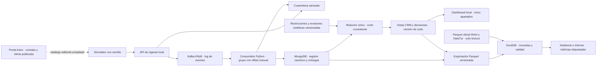
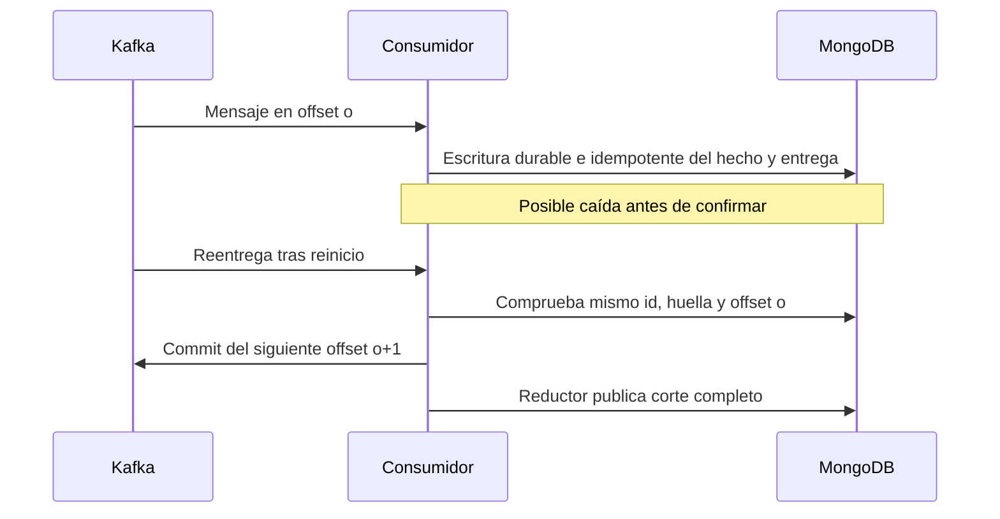

# Arquitectura de ejecución y recuperación

**Diseño del 25 de noviembre de 2026.** Almacenamiento de grandes volúmenes, Universidad Rosario Castellanos. La fase de diseño fija dónde nace cada dato, quién confirma su durabilidad y qué lee mercadotecnia. El cumplimiento se acredita con los resultados de ejecución posteriores. [Decisión](bigdata04-adr-kappa.md) · [Contrato](bigdata04-contratos.md).

## Recorrido de una acción

1. El simulador lee una instantánea mínima y emite por HTTP un evento sintético reproducible. El sitio público carece de conexión de red a este sistema. En `POST /events` la API valida forma, catálogos, límites, tipo y procedencia. `GET /health` indica si puede publicar; es conveniente distinguir salud del proceso y disponibilidad del broker.
2. La API sella `received_at`. Un evento válido obtiene confirmación HTTP 202 tras el acuse del broker. Un resultado desconocido por timeout se comunica como reintentable; el cliente reenvía el mismo `event_id`. Los errores de contrato reciben 4xx con motivo enumerado y cuarentena mínima. Si la cuarentena requerida está indisponible, se registra el fallo de dependencia y se reintenta sin declarar persistencia.
3. Kafka añade a un log durable. El consumidor valida de nuevo incluso si el mensaje llegó sin pasar por HTTP. Clasifica cada entrega (nuevo, duplicado, conflicto o rechazado). Una entrega nueva escribe el documento canónico y deja trazabilidad por tópico, partición y offset. Para confirmar el siguiente offset debe haberse completado la persistencia de todo el prefijo anterior de la partición; una falla de MongoDB detiene la confirmación. `poll` y el tamaño de lote deben ser compatibles con los timeouts de grupo.
4. El reductor toma un corte de entregas durables, desduplica por identidad canónica, resuelve estados y atribuye CTR. El tablero lee una sola versión publicada por actualización. Puede mostrar la antigüedad del corte durante un fallo y un estado degradado explícito. Los números de proceso, intentos y tiempos son telemetría operacional distinta de los hechos de negocio.
5. El exportador fija la versión, guarda Parquet con compresión, publica al final un manifiesto con zona, contrato, semilla, esquema, filas, SHA-256 y posición del corte. DuckDB lee esa versión. Un archivo incompleto carece de manifiesto publicable. Los resultados del tablero y del SQL se comparan sobre la misma corrida y corte.

## Broker y aislamiento

| Parámetro de laboratorio | Valor o regla de operación |
|---|---|
| Broker | Kafka 4.3.1 en modo KRaft, un broker/controlador, volúmenes nombrados y clúster persistente con identificador estable. Retención por eliminación, sin compactación en el registro de eventos. |
| Tópicos | Uno de entrada (tres particiones iniciales) y uno de cuarentena (una partición), ambos con réplica 1. Los nombres configurados se documentan en Compose. Los estados reconstruibles se sirven en Mongo. No se necesita tópico adicional de indicadores. |
| Clave y orden | UTF-8 de (corrida, actor), con separador inequívoco. Garantiza la misma partición para todas sus sesiones y rutas al mantener el mismo particionador y número de particiones. Las operaciones sobre restricciones se identifican por (corrida, destino, revisión), en un registro de control versionado. Kafka preserva orden de offset **dentro de la partición**. |
| Retención de partida | Siete días para entrada y cuarentena; limitar adicionalmente bytes por partición según espacio disponible (punto de partida, 256 MiB). Registrar configuración efectiva y offsets inicial/final. El replay desde Kafka depende del primer offset disponible y del tamaño de segmento. |
| Publicación y consumo | `acks=all`, productor idempotente si lo admite el cliente, reintentos transitorios limitados con espera creciente y timeout. Grupo estable; desactivar auto-commit. Grupo nuevo de replay o asignación explícita de particiones. No cambiar offsets del grupo en vivo para demostrar replay. |
| Límites | Red privada Compose; MongoDB sin puerto publicado; API y tablero expuestos únicamente en loopback; Kafka interno o listener local explícito cuando lo exige el generador. Healthchecks realizan comprobación funcional. No se aceptan credenciales Atlas, conexión con plataformas publicitarias, direcciones de clientes ni cuerpos crudos en logs o métricas. |

La réplica única permite probar reinicio de procesos con disco conservado. Fallos de disco, multirregión y alta disponibilidad requieren un ensayo distinto. Al subir el número de particiones, las claves antiguas podrían empezar a dirigirse a otras particiones. Para un cambio real se requiere migración con corte y reconciliación. [Kafka, particiones y entrega](https://kafka.apache.org/41/design/design/) · [Opciones de consumidor](https://kafka.apache.org/43/configuration/consumer-configs/).

## MongoDB y publicación de vistas

Base exclusiva `slp_bigdata04_demo`. Los nombres equivalentes de colecciones se fijan en el README. La tabla define las claves lógicas mínimas. En identificadores compuestos debe usarse codificación sin colisiones. Todos los índices llevan el ámbito de corrida donde lo requiere la consulta.

| Colección lógica | Grano, índice y uso |
|---|---|
| `events` | Un evento canónico por `_id = event_id`, índice único nativo. Cuerpo validado, huella de negocio, primera posición y recepción. Índices por corrida/tipo/tiempo y corrida/actor/secuencia según el patrón de lectura. |
| Entregas y cuarentena | Registro por (tópico, partición, offset), único. Mismo offset releído por reinicio conserva su clasificación original. Dos offsets con mismo evento se distinguen de la relectura de un offset. Para fallos HTTP la cuarentena conserva solo motivo, procedencia sintética segura y metadatos mínimos. |
| `route_state`, `favorite_state` | Un estado por clave de pertenencia del contrato, con último orden lógico, activo e id del evento. El historial se obtiene por consulta al registro canónico. |
| `campaign_metrics` | Una celda por corrida, corte, ventana de impresión UTC, familia y dimensiones elegidas. Conserva numerador y denominador. El dashboard puede agrupar las celdas compatibles. |
| `processing_runs`, `quality_reports` | Configuración de corrida, versión del catálogo y reductor, offsets, watermark, heartbeat, estado de corte, fallos y contabilidad. Un documento de control identifica el último corte completo. |
| `destination_constraints_demo` y decisiones | Historial de revisiones por (corrida, destino, revisión) con unicidad. Decisiones por corte, versión de regla, destino y revisión, incluyendo motivo, insumos y unidad de capacidad. |

Un escritor por grupo al inicio. Si se usan documentos separados para entrega y hecho, la operación debe poder repararse. Un patrón para Mongo standalone es el upsert inmutable por `event_id`, con `$setOnInsert` y posición original, seguido del upsert de entrega por posición. Al releer después de una caída, la posición original identifica el evento como nuevo en ese offset y permite reparar la bitácora. Un `event_id` con otros datos de negocio se pone en cuarentena y la corrida queda marcada como conflictiva para publicación; una relectura conserva la evidencia. Nunca se usa incremento de contadores sin identidad de contribución. [Atomicidad de MongoDB](https://www.mongodb.com/docs/manual/core/write-operations-atomicity/) · [Índices únicos](https://www.mongodb.com/docs/manual/core/index-unique/).

Una implementación simple recalcula estados y celdas en lotes o a intervalos acotados, con un solo reductor Python. Para aislamiento se puede materializar bajo una generación nueva y publicar al final un puntero atómico con offsets y versión de restricciones. También es válida una instantánea autocontenida si cabe en los límites de Mongo, dejando estados grandes fuera del documento. La lectura debe resolver completamente un corte y mostrar su hora. El último corte debe terminar aunque el flujo quede ocioso. Durante el benchmark debe medirse el coste de reconstrucción. Las proyecciones incrementales requieren el mismo oráculo y pruebas de equivalencia.

## Fallos y reprocesamiento

| Momento de fallo | Recuperación y resultado esperado |
|---|---|
| Publicación con respuesta HTTP perdida | El broker puede tener dos entregas si el cliente repite. Un solo evento produce efectos de negocio. |
| Antes de persistir o entre escritura y commit | Reentrega con el mismo offset. Se completa el prefijo y se conserva una sola contribución canónica. |
| Después del commit, antes de publicar la vista | El registro durable permite completar o regenerar la vista al arrancar, incluso sin nuevos eventos. |
| En la exportación o al crear un corte | Continúa vigente la última versión completa. El nuevo intento crea otra salida o reanuda la generación incompleta. |
| Retención vencida | El archivo canónico más las revisiones de restricciones y catálogos permite replay de negocio. Recomponer intentos/redelivery exige además conservar el registro de entregas. El consumidor informa si la posición solicitada ya no existe. |

El replay tiene un nuevo identificador de procesamiento, preserva `simulation_run_id`, identidades, timestamps de negocio y versiones. Compara corpus y salidas en un espacio aislado sin modificar el grupo o la base activa. Se usa el mismo código de reducción y una hora `as_of` fijada para reglas con vigencia. Compara hashes lógicos sobre filas ordenadas y con tipos normalizados, excluyendo nueva duración de ejecución y sellos técnicos. La garantía es entrega al menos una vez, escrituras de negocio idempotentes y convergencia de proyecciones. Las interfaces HTTP, Kafka, Mongo y archivos no participan de una sola transacción distribuida.

## Regla de sustentabilidad v1

[SIMULADO] Se evalúa cada destino a una fecha de decisión UTC. Una revisión lleva capacidad autorizada y reservas en **plazas para el mismo destino e intervalo**, disponibilidad operativa, acceso, estado ambiental, inicio y fin de vigencia, fuente ficticia controlada y verificación de laboratorio. Se conserva la revisión como evento/control histórico, acotado al ámbito de la corrida. Se aplica la revisión más reciente conocida al corte y efectiva para la fecha de decisión. Una actualización o vencimiento obliga a evaluar nuevamente. El historial debe permitir reproducir tanto la decisión anterior como la nueva.

| Prioridad | Condición | Resultado y motivo mínimos |
|---|---|---|
| 1 | Falta información, falta fuente/verificación, valores imposibles o vigencia vencida | Sin elegibilidad para incrementar; se identifica la condición faltante. |
| 2 | Destino indisponible, acceso restringido/cerrado o alerta ambiental de bloqueo | Pausa por condición operativa, independientemente de la exposición. |
| 3 | Plazas disponibles = capacidad − reservas, por debajo del cupo necesario para el escenario (mínimo de laboratorio positivo, documentado) | Pausa por capacidad. Un CTR alto conserva el bloqueo. Reservas que exceden capacidad también bloquean. |
| 4 | Todas las restricciones completas y satisfechas | Candidato sujeto a validación humana. Poca exposición puede orientar el orden de revisión. |

La puerta operacional precede a cualquier ranking digital. Histórico oficial y CRM se presentan con columnas, granos y procedencia visibles; el único contexto compartible sin validación territorial adicional es el periodo. Para leer material existente se abre `.bigdata-private/bigdata03-final-1/campaign.duckdb` en modo de solo lectura o sus Parquet. Ningún proceso sobrescribe Raw, Gold, Atlas ni el portal. Contrato histórico (referencia del repositorio de origen) · [Pruebas](bigdata04-plan-pruebas.md).
