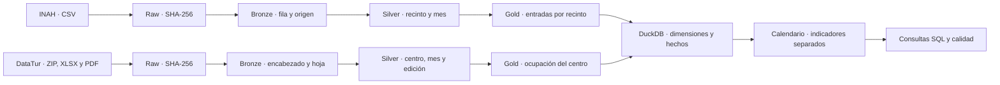

# Flujo analítico

El diagrama representa las ejecuciones históricas de Big Data 02 y 03. La demostración utiliza entradas generadas [SIMULADO] y la misma lógica de transformación y consulta cuando se indica.
